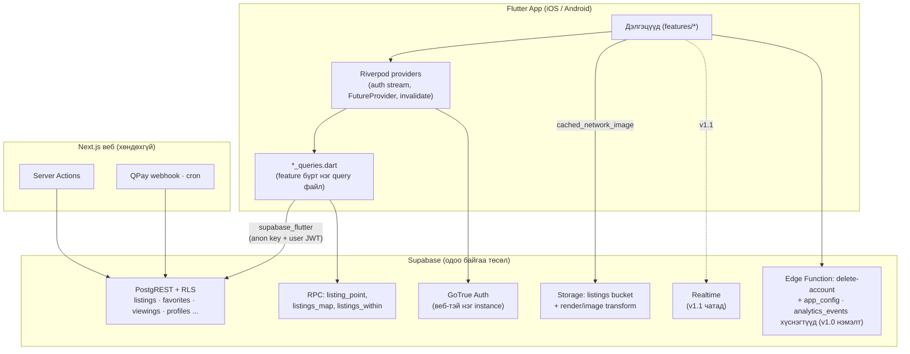

# Nemi Mobile App — Хэрэгжүүлэлтийн төлөвлөгөө (Flutter Consumer App)

> Хувилбар: 1.0 · Огноо: 2026-07-18
> Хамрах хүрээ: Хэрэглэгчийн (consumer) апп — iOS + Android, Flutter
> Backend: Одоо ажиллаж буй Supabase төсөл (Next.js веб аппын backend-ийг шууд дахин ашиглана)

---

## 1. Товч хураангуй

Nemi-ийн веб апп (Next.js 16 + Supabase) бүрэн ажиллагаатай болсон тул дараагийн алхам нь **хэрэглэгчийн гар утасны апп**. Энэ төлөвлөгөөний гол шийдвэр:

- **Flutter апп Supabase-тай ШУУД харьцана** (`supabase_flutter` → PostgREST + GoTrue + Storage). Дунд нь ямар ч REST/API давхарга барихгүй.
- **v1.0-д backend-ийн өөрчлөлт бага.** Бүх v1.0 дэлгэц одоо байгаа RLS policy эсвэл anon-эрхтэй RPC дээр шууд буудаг (`listings`, `listing_photos`, `agents`, `favorites`, `recently_viewed`, `viewings`, `profiles`, `listing_point`). Нэмэлтүүд (§2.2): **бүртгэл устгах Edge Function** (App Store/Play Store-ийн заавал шаардлага), **`app_config` min-version kill switch**, **`analytics_events` хүснэгт**, Auth redirect URL тохиргоо, staging төсөл (тест).
- **7 дэлгэц (+ нууц үг сэргээх гүйцээх дэлгэц), ~5 долоо хоногт store-д гаргана** (1 Flutter хөгжүүлэгч).
- Сервер талын ажил шаардах хоёр боломж — **чат** ба **хэрэглэгч өөрөө зар оруулах** — v1.1 / v1.2 руу ухамсартайгаар хойшлуулж, тус бүрд нь нэг migration-ий тодорхой зам зааж өгсөн. Архитектур хаана ч мухардахгүй.

### Аппын зорилго

Улаанбаатарын үл хөдлөхийн худалдан авагч/түрээслэгчид зориулсан: зар хайх → шүүх → дэлгэрэнгүй үзэх → **агент руу залгах** (v1.0-ийн №1 conversion үйлдэл) → үзэлт товлох → хадгалах. Веб болон мобайл нэг Supabase auth тул хэрэглэгчийн бүртгэл, хадгалсан зар хоёр платформ дээр автоматаар нийлдэг.

### Юу ОРОХГҮЙ (consumer-only хил хязгаар)

- Агентын панель, оффисын панель, админ панель
- CRM: `leads`, `lead_activities`, `projects`, tasks модуль
- QPay Premier subscription (агентын төлбөр — веб дээрээ үлдэнэ)
- Зээлийн тооцоолуур, rent-afford, мэдээ (news), AI маркетингийн хуудсууд
- Агент/оффисын лавлах (directory) хуудсууд — зарын дэлгэрэнгүй дээрх агентын карт хангалттай

---

## 2. Одоогийн backend-ийн дүгнэлт

### 2.1 Шууд дахин ашиглах зүйлс (backend-д гар хүрэлгүйгээр)

**Auth (GoTrue):** Веб-тэй нэг instance. И-мэйл+нууц үг signup → `handle_new_user()` trigger `profiles` мөр үүсгэж, metadata-д role байхгүй бол `buyer` default болно. Веб/мобайл нэг бүртгэл — favorites автоматаар sync.

**RLS — хэрэглэгчийн бүх эрхийн загвар аль хэдийн кодлогдсон:**

| Хүснэгт | Consumer-т юу боломжтой | Policy баримт |
|---|---|---|
| `listings` | SELECT (зөвхөн `status='active'`) — anon ч үзнэ | `listings_select`: `status='active' or can_manage_agent(agent_id)` |
| `listing_photos` | SELECT бүгд (anon ч) | `using (true)` |
| `agents`, `offices`, `reviews`, `ai_valuations` | SELECT бүгд (anon ч; `agents.phone` нээлттэй → залгах товч) | `using (true)` |
| `favorites` | Өөрийн мөрөнд бүрэн CRUD | `for all (user_id = auth.uid())` |
| `saved_searches` | Өөрийн мөрөнд бүрэн CRUD | мөн адил |
| `recently_viewed` | Өөрийн мөрөнд бүрэн CRUD (upsert) | мөн адил |
| `viewings` | INSERT (`buyer_id = auth.uid()`), өөрийн мөрөө UPDATE (цуцлах) | `viewings_insert/update` |
| `profiles` | Өөрийн мөрөө SELECT/UPDATE | `id = auth.uid()` |
| `notifications` | Өөрийн мөрөө SELECT, `read_at` UPDATE | INSERT нь service-role only |
| `conversations`/`messages` | Буйер insert/select (v1.1-д ашиглана) | доорх 2.2-ыг үз |

**RPC (anon + authenticated эрхтэй):**
- `listing_point(p_id)` → `{lng, lat}` — зарын координат (PostGIS geography-г PostgREST WKB hex буцаадаг тул энэ RPC заавал хэрэгтэй)
- `listings_map()` — идэвхтэй бүх зарын цэг (v1.1 газрын зурагт)
- `listings_within(lng, lat, m)` — ойролцоох хайлт (v1.1)

**Storage:** `listings` bucket public read. `listing_photos.url` бүрэн public URL хадгалдаг тул зураг татах нь энгийн HTTP GET. **Чухал graft:** картын thumbnail-д Supabase-ийн image transformation ашиглана — `/storage/v1/render/image/public/listings/{path}?width=480&quality=75`. Зургууд бүрэн хэмжээгээрээ хадгалагддаг, сервер талын resize байхгүй тул УБ-ын мобайл дата дээр feed-ийн хурд аппын хамгийн том мэдрэгдэх асуудал болно — энэ нэг мөр URL өөрчлөлт үүнийг шийднэ.

> **Анхаар — transformation нь Pro+ plan-ийн боломж.** `render/image` endpoint зөвхөн Supabase Pro ба түүнээс дээш plan дээр ажилладаг; free-tier төсөл дээр эдгээр URL алдаа буцаана. Phase 0-д төслийн plan tier-ийг шалгаж, нэг transform URL-ийг бодитоор туршина. **Fallback:** transform боломжгүй бол `object/public` original URL + клиент талын `cacheWidth`/`ResizeImage` decode шахалт (`image_url.dart` дотор нэг flag-аар солигдоно). Мөн `thumbUrl()` хөрвүүлэгч нь Supabase storage биш URL-ийг (legacy `listings.photo` утгууд external байж болно) **өөрчлөлгүй pass-through** хийнэ.

**Веб кодоос шууд порт хийх:**
- `lib/constants.ts` → `PROPERTY_TYPES` (6, "Обьект" орсон), `DISTRICTS` (7 дүүрэг), `DEAL_TYPES` + `DEAL_TYPE_LABEL`, `RENT_TERM_PRESETS`, `rentTermCode`/`rentTermLabel`
- `lib/format.ts` → `fmtMNT` (₮, сая/тэрбум формат)
- `lib/queries.ts`-ийн query логик (ялангуяа `CARD_SELECT`, `getListings`-ийн filter mapping) — Dart дээр мөр мөрөөр нь давтана

### 2.2 Жижиг backend нэмэлт хэрэгтэй зүйлс

| Хэрэгцээ | Шалтгаан (backend баримт) | Хэзээ | Ажил |
|---|---|---|---|
| **Бүртгэл устгах** | `profiles`-д DELETE policy байхгүй; `auth.users` устгах нь service-role шаардана. Apple (2022 оноос) болон Google Play хоёулаа апп дотроос бүртгэл устгах замыг ЗААВАЛ шаарддаг — байхгүй бол шууд reject. | **v1.0 (launch blocker)** | Нэг Supabase Edge Function `delete-account`: хэрэглэгчийн JWT-ээр дуудагдаж, service-role-оор `auth.admin.deleteUser()` — cascade-аар profiles/favorites г.м устна. **Spec:** (1) `profiles.role != 'buyer'` эсвэл `agents` мөр (`profile_id`) байвал устгахаас ТАТГАЛЗАЖ ойлгомжтой алдаа буцаана — агентын public directory мөр, зарууд орфон болохоос сэргийлнэ; (2) FK семантикийн ялгааг (`reviews.author_id`, `messages.sender_id` set null vs cascade) тесттэйгээр enumerate хийнэ; (3) амжилтын дараа клиент локалдаа `signOut()` хийнэ. (~1 өдөр) |
| **Хамгийн бага дэмжигдэх хувилбар (kill switch)** | Мобайл binary store review-ээр хэдэн өдөр хоцордог (§12 #5); breaking backend өөрчлөлт гарвал хуучин binary-д ямар ч remediation зам байхгүй — дараа нь retrofit хийх боломжгүй. | **v1.0** | Нэг мөртэй `app_config` хүснэгт (public SELECT, service-role write) — `min_supported_version` талбартай. Апп launch бүрт шалгаж, хувилбар нь бага бол blocking "Шинэчлэх" дэлгэц (store линктэй) харуулна. (~0.5 өдөр) |
| **Аналитик sink** | §9-ийн event-үүдийг (`call_tap`, `search_zero_results` г.м) бүртгэх газар v1.0-д байх ёстой; anon хайлтын лог тул `user_id is null` insert зөвшөөрөх хэрэгтэй. | **v1.0** | Insert-only `analytics_events` хүснэгт: `with check (user_id = auth.uid() or user_id is null)`, SELECT нь service-role only. Нэг жижиг migration. (§9-ийг үз) |
| **Auth redirect URL** | `signUp`/`resetPasswordForEmail` нь веб рүү (`{origin}/auth/callback`) чиглүүлдэг | v1.0 | Supabase Auth тохиргоонд `nemi://auth-callback` нэмэх (код биш, dashboard тохиргоо) |
| **Чатын trigger** | `sendMessage` веб дээр admin client-ээр `notifications` insert хийдэг; `messages`-д UPDATE policy байхгүй тул `read_at` тавигдахгүй; `conversations.last_message_at` bump action кодонд байдаг | v1.1-ийн өмнө | Нэг migration: `after insert on messages` security-definer trigger (last_message_at bump + notification insert) + `mark_read(conversation_id)` RPC эсвэл нарийн UPDATE policy + `(buyer_id, listing_id, agent_id)` unique partial index (dedupe) |
| **Газрын зургийн RPC өргөтгөл** | `listings_map()` идэвхтэй БҮХ зарын цэгийг буцаадаг (сайт 12,000+ зар гэж мэдэгддэг) — мянга мянган `Marker` нь 2GB RAM төхөөрөмж дээр jank үүсгэнэ; мөн RPC нь `deal_type`, `photo`, `rooms` буцаадаггүй тул шүүлт/preview карт хийхэд хоёр дахь query хэрэгтэй болно | v1.1-ийн өмнө (чатын migration-тай хамт) | Жижиг migration: `listings_map()`-ийн буцаах баганад `deal_type`, `photo`, `rooms` нэмэх ЭСВЭЛ viewport-оор хязгаарласан шинэ bounded RPC; клиент талд `google_maps_cluster_manager`-ээр clustering |
| **Хэрэглэгч зар оруулах** | `listings_insert` нь `can_manage_agent(agent_id)` шаарддаг; `createListing` "Зөвхөн агент зар оруулна." гэж алддаг; `listings` bucket агент бус хэрэглэгчийн upload-ыг хаадаг (`20260615000200_authz_hardening.sql`) | v1.2-ийн өмнө | `listing_submissions` хүснэгт (owner-only RLS) + тусдаа storage prefix + админ веб дээр батлах дэлгэц. `listings` policy-г СУЛРУУЛАХГҮЙ. |
| **Push token** | `notifications`-ыг cron/chat сервер талд бичдэг, push илгээх зам байхгүй | v1.2 | `device_tokens` хүснэгт + notification бичдэг цэгүүдэд FCM илгээлт залгах |

### 2.3 Мэдэж байх ёстой anon "цоорхой" (аппаар засахгүй, backend эзэнд мэдэгдэнэ)

- `listing_photos` SELECT `using (true)` — идэвхгүй зарын зураг ч уншигдана
- `listing_point` нь security definer, status шүүлтгүй — идэвхгүй зарын координат ч буцаана

Апп эдгээрт **найдахгүй** (зөвхөн active зартай ажиллана), гэхдээ засварыг backend талд тусад нь хийнэ.

---

## 3. Архитектур

**Шийдвэр: Direct-to-Supabase. API давхарга байхгүй.**

Яагаад:
1. **Веб аппд дуудаж болох API огт байхгүй.** Бүх consumer mutation Next.js Server Actions (`lib/actions/favorites.ts`, `viewings.ts`, `chat.ts`, `profile.ts`) — эдгээр нь public HTTP contract биш, Flutter дуудаж чадахгүй. PostgREST-ийг proxy-дсон REST façade барих нь цэвэр шинэ surface — MVP-ийн эсрэг.
2. **RLS аль хэдийн аюулгүй байдлын хил.** Anon key нь public байхаар зохиогдсон; `20260615000200_authz_hardening.sql`-ээр яг энэ хэрэглээнд зориулж хатуурсан.
3. Server-side логик (QPay webhook, cron search-alerts, AI valuation) хэрэглэгч талаас огт дуудагддаггүй — хөндөхгүй.



**Давхаргууд (зориуд цөөн):**
- **UI (features/)** — дэлгэц + widget
- **State (Riverpod)** — auth stream, async кэш, mutation дараах `ref.invalidate(...)` (вебийн `revalidatePath`-ийн орлуулалт)
- **Query (feature бүрт нэг Dart файл)** — `lib/queries.ts`-ийн шууд толь. Repository interface / usecase давхарга ХИЙХГҮЙ — 7 дэлгэцтэй аппд илүүц ёслол.
- **Model** — гараар бичсэн `fromJson`, ~5–6 модель. freezed/json_serializable codegen ХЭРЭГГҮЙ.

---

## 4. Технологийн стек

| Package | Хувилбар (pub.dev stable) | Шалтгаан |
|---|---|---|
| Flutter SDK | 3.32+ / Dart 3.8+ | Одоогийн stable |
| `supabase_flutter` | ^2.9 | Клиент, auth persistence (secure storage дотроо), PostgREST, Storage, Realtime-ready. Бүхэл backend стратеги энэ нэг package. |
| `flutter_riverpod` | ^2.6 (codegen-гүй хэлбэр) | Яг 3 хэрэгцээ: auth stream, `FutureProvider.family` кэш, invalidate. Bloc/get_it — 7 дэлгэцэд overkill; `setState` — auth-gating дээр эвдэрнэ. |
| `go_router` | ^16 | Declarative deep link (`/listings/:id`), auth redirect guard |
| `cached_network_image` | ^3.4 | Диск кэш — УБ-ын мобайл дата дээр заавал |
| `url_launcher` | ^6.3 | `tel:${agent.phone}` — v1.0-ийн №1 conversion; `geo:` URI-гаар Google Maps апп нээх |
| `app_links` | ^6 | `nemi://auth-callback` deep link (и-мэйл баталгаажуулалт, нууц үг сэргээх) |
| `intl` | ^0.20 | Огноо/тооны MN формат |

**Зориуд ОРУУЛАХГҮЙ (v1.0):**
- `google_maps_flutter` — платформ бүрт native API key + billing тохиргоо. Оронд нь: дэлгэрэнгүй дээр "Байршил" товч → `listing_point` координатаар `geo:`/Google Maps апп нээнэ. SDK зардал тэг.
- `firebase_messaging` — push-лах зүйл байхгүй үед push байхгүй (§9-ийг үз)
- `flutter_dotenv` — оронд нь `--dart-define-from-file` (нэг package бага)
- dio/retrofit, freezed, json_serializable, drift/offline DB — PostgREST клиент өөрөө HTTP давхарга; offline queue нь idempotent upsert дээрх retry-г дэд бүтэц болгож хувиргасан over-engineering

Env: вебийн `NEXT_PUBLIC_SUPABASE_URL` + anon key-г `--dart-define-from-file=env/prod.json`-оор build-д оруулна.

---

## 5. Төслийн бүтэц

```
nemi_mobile/
  env/
    prod.json                 # SUPABASE_URL, SUPABASE_ANON_KEY (--dart-define-from-file)
    staging.json              # Phase 0-д ШИНЭЭР үүсгэх staging Supabase төслийн key-үүд (§7 Phase 0)
  lib/
    main.dart                 # Supabase.initialize, ProviderScope, MaterialApp.router
    core/
      supabase.dart           # глобал клиент getter
      router.dart             # go_router + auth redirect guard
      format.dart             # fmtMNT, rentTermCode/Label — lib/format.ts + constants.ts порт
      constants.dart          # PROPERTY_TYPES, DISTRICTS(7), DEAL_TYPES — lib/constants.ts-ээс ҮГЧЛЭН
      theme.dart              # брэнд улбар шар (brand-500), MN typography
      image_url.dart          # thumbUrl(url, width) — render/image transform + fallback (cacheWidth) + non-Supabase URL pass-through (§2.1)
    models/
      listing.dart            # ListingCard + ListingDetail (гар fromJson; agent талбар NULLABLE — §13; join-оор ирсэн listing объект мөн NULLABLE — §6-гийн RLS-null тайлбар)
      agent.dart
      viewing.dart
      profile.dart
    features/
      home/                   # хайлтын оролт + онцлох rail
      listings/               # жагсаалт, шүүлтүүр sheet, listings_queries.dart
      listing_detail/         # detail_queries.dart (recordView upsert энд)
      favorites/
      viewings/
      auth/                   # login, signup, forgot-password, шинэ-нууц-үг (passwordRecovery), deep-link handler
      account/                # профайл засах, recently viewed, бүртгэл устгах
  test/
  integration_test/
```

Дүрэм: **select string бүр зөвхөн `*_queries.dart` файлд** — schema өөрчлөлтөд нэг л газар засна (§12 эрсдэл #5).

---

## 6. Дэлгэцийн зураглал (v1.0 — 7 дэлгэц + шүүлтүүр sheet)

Зарчим: **anonymous-first** — үзэхэд нэвтрэлт шаардахгүй; нэвтрэлтийг зөвхөн эхний хамгаалагдсан үйлдэл дээр (зүрх дарах, үзэлт товлох) асууна — вебийн `LoginPrompt` хэв маяг.

Bottom nav: **Нүүр · Хайх · Хадгалсан · Профайл**

| # | Дэлгэц | Өгөгдөл | Үйлдлүүд |
|---|---|---|---|
| 1 | **Нүүр** | Онцлох rail: `listings` where `status='active', featured=true` order `ai_score desc` limit 8 (вебийн `getFeaturedListings`-тэй ижил query) | Хайлтын мөр → Хайх дэлгэц; deal-type chips (Худалдах/Түрээс — `DEAL_TYPE_LABEL`) |
| 2 | **Зарын жагсаалт** | Infinite scroll: `.range()` offset pagination, pageSize 12, `count:'exact'` (`getListings` порт). Карт зураг: `render/image?width=480` | Шүүлтүүр bottom sheet — вебийн `ListingFilters`-тэй ижил: `q` (title ilike), `deal`, `district` (7 сонголт), `type`, `rooms` (gte), `minPrice`/`maxPrice`, `posted` (1/3/7/30 хоног — `gte created_at`), `sort` (new/price_asc/price_desc/ai). Saved-search filter JSON (v1.1) веб-тэй тааруулахын тулд `posted`-ыг мөн вебийн кодчлолтой ижил хадгална. Backend дэмждэггүй шүүлтүүр НЭМЭХГҮЙ (хороо гэж байхгүй). 0 үр дүнтэй хайлтын лог (§9 аналитик) |
| 3 | **Зарын дэлгэрэнгүй** | `LISTING_DETAIL_SELECT` порт: `*` + agent(+office) + `photos:listing_photos` (sort_order-оор) + valuations. Үнэ `fmtMNT` (+"/сар" түрээст), spec tiles (өрөө/м²/давхар/он/зогсоол), түрээсийн нөхцөл (`rent_advance_months`/`rent_deposit_months` → `rentTermCode` "1+1"), AI оноо + `ai_note`, amenities, агентын карт (нэр, verified, rating/reviews_count, оффисын өнгөт initials) | **[Залгах]** sticky товч (tel:) — №1 conversion; **Үзэлт товлох** (`viewings` insert, `status:'pending'`, `buyer_id=self`, **`agent_id=listing.agent.id` — ЗААВАЛ**: агент талын RLS SELECT/UPDATE нь `owns_agent(agent_id)` тул `agent_id` null явуулбал агент хүсэлтийг хэзээ ч харахгүй, feature чимээгүй үхнэ; вебийн `bookViewing(listingId, agentId, scheduledAt)`-тай ижил гурван утга); зүрх toggle; "Байршил" → `listing_point` RPC → geo URI. Нээгдэхэд fire-and-forget `recently_viewed` upsert (`onConflict: user_id,listing_id` — `recordView` логик) |
| 4 | **Хадгалсан** | `favorites` join `listing:listings(CARD)` (`getFavoriteListings` порт), `created_at desc` | Swipe-аар хасах (own-row DELETE). Embedded `listing == null` мөрд "Зар идэвхгүй болсон" төлөвт карт (доорх RLS-null тайлбар) |
| 5 | **Миний үзэлтүүд** | `getMyViewings` порт: `buyer_id=self`, join listing(id,title,district,photo,price) + agent(display_name,phone), `scheduled_at asc` | Статус chip: pending=шар "Хүлээгдэж буй", confirmed=ногоон, done=саарал, cancelled=улаан (вебийн өнгөний семантик). Цуцлах = own-row UPDATE `status:'cancelled'` (RLS зөвшөөрдөг). Embedded `listing == null` бол "Зар идэвхгүй болсон" төлөв (доорх RLS-null тайлбар) |
| 6 | **Auth** | Login / Signup / Нууц үг сэргээх + **"Шинэ нууц үг" дэлгэц**. Signup-д role metadata ӨГӨХГҮЙ → trigger buyer default. `emailRedirectTo: nemi://auth-callback` | **v1.0 зөвхөн и-мэйл** — Google OAuth-ыг алгасах нь Apple-ийн заавал "Sign in with Apple" (guideline 4.8) шаардлагыг бүхэлд нь тойрдог. OAuth v1.1-д. **Нууц үг сэргээх ГҮЙЦЭЭХ урсгал:** reset и-мэйл → `nemi://auth-callback` → `supabase_flutter` нь `AuthChangeEvent.passwordRecovery` event-ийг session-тэй хамт emit хийнэ — аппын auth listener энэ event-ийг барьж "Шинэ нууц үг" дэлгэц рүү чиглүүлж, `updateUser(password)` дуудна. Энэ handler байхгүй бол линк хэрэглэгчийг зүгээр л нэвтрүүлээд нууц үг хэзээ ч солигдохгүй. Мөн вебийн recovery линк implicit-flow hash token (`/auth/confirm` хэв маяг) ашигладаг — мобайл redirect дээр Supabase яг ямар token формат явуулдгийг `supabase_flutter`-ийн deep-link handling бодитоор дааж байгааг Phase 2-т туршиж баталгаажуулна. |
| 7 | **Профайл** | Өөрийн `profiles` мөр (full_name, phone, email) | `full_name`/`phone` засах (own-row UPDATE — `updateProfile` порт); Хадгалсан/Үзэлт/Сүүлд үзсэн (limit 20, `viewed_at desc`; embedded `listing == null` мөрийг нууна — доорх RLS-null тайлбар) линкүүд; Гарах; **Бүртгэл устгах** — баталгаажуулалттай, `delete-account` Edge Function дуудна (store-ийн заавал шаардлага) |

**RLS-null болсон embedded listing (Хадгалсан · Миний үзэлтүүд · Сүүлд үзсэн — гурвууланд нь ЗААВАЛ):** эдгээр query `listing:listings(...)` join хийдэг, харин `listings_select` policy зөвхөн `status='active'` мөрийг үзүүлдэг тул хадгалсан зар зарагдах/draft болоход **эх мөр буцаад ирдэг ч embedded `listing` объект null болдог**. Marketplace-д зар байнга идэвхгүй болдог тул энэ нь баталгаат crash/ghost-row эх үүсвэр. Шийдэл: (1) моделийн `fromJson`-д join-оор ирсэн `listing`-ийг nullable гэж загварчилна; (2) UI: Хадгалсан ба Миний үзэлтүүд дээр "Зар идэвхгүй болсон" төлөвт мөр харуулна, Сүүлд үзсэн дээр мөрийг нуана; (3) идэвхгүй болсон зар руу очих deep link дээр detail query `maybeSingle` семантикаар null буцаана — "Зар олдсонгүй/идэвхгүй" дэлгэц харуулна, crash хийхгүй.

---

## 7. Үе шаттай төлөвлөгөө

### Phase 0 — Суурь (4–5 өдөр)

- [ ] Flutter төсөл үүсгэх, bundle id (`mn.nemi.app`), env `--dart-define-from-file`
- [ ] **Хамгийн бага OS хувилбарыг pin хийх:** Android `minSdkVersion` 23–24, iOS deployment target 13+ (`supabase_flutter` 2.x-ийн шаардлагатай нийцүүлж) — энэ шийдвэр package сонголт (`google_maps_flutter`, `app_links`) болон store listing-ийг gate хийдэг тул ухамсартай, эхэнд нь тогтооно
- [ ] **Staging Supabase төсөл ҮҮСГЭХ** (одоо байхгүй — backend нь ганц production төсөл): шинэ Supabase project → `supabase/migrations/*` бүгдийг apply → `scripts/seed.mjs` ажиллуулах → key-үүдийг `env/staging.json` + CI secrets-д холбох. Үүнийг хийхгүй бол CI contract/integration тестүүд prod дээр (эсвэл огт юун дээр ч биш) гүйнэ. *Fallback (staging хойшлогдвол): contract тестийг prod дээрх READ-ONLY query-ээр хязгаарлаж, seed хэрэглэгчийн login тестийг хасна.*
- [ ] **Image transformation-ийг баталгаажуулах:** Supabase төслийн plan tier-ийг шалгаж (transformation нь Pro+ л ажилладаг — §2.1), нэг `render/image` URL-ийг бодитоор туршина; ажиллахгүй бол `image_url.dart`-ийн fallback (original + `cacheWidth`) идэвхжүүлнэ
- [ ] `Supabase.initialize` + `core/supabase.dart`
- [ ] `go_router` + auth redirect guard (нэвтрээгүй → гated route-оос login руу)
- [ ] `theme.dart` — брэнд улбар шар, MN Cyrillic typography
- [ ] `constants.dart` — `lib/constants.ts`-ээс үгчлэн порт; `format.dart` — `fmtMNT`, `rentTermCode`
- [ ] Моделүүд (~5): ListingCard, ListingDetail, Agent, Viewing, Profile — nullable-tolerant гар `fromJson`
- [ ] `image_url.dart` — `object/public` → `render/image/public` + `?width=` хөрвүүлэгч; Supabase биш URL-ийг pass-through; transform боломжгүй үеийн `cacheWidth` fallback (§2.1)
- [ ] CI: `flutter analyze` + build + **contract test**: staging-аас `select distinct type, district from listings` татаж Dart constants-тай diff (§12 #3)

**Хүснэгт/RPC:** байхгүй (суурь). **Үр дүн:** хоосон гэхдээ navigation-той, theme-тэй апп CI дээр build хийгдэнэ.

### Phase 1 — Үзэх урсгал, anon (1.5 долоо хоног)

- [ ] Нүүр: онцлох rail (`featured=true`, `ai_score desc`, limit 8)
- [ ] Жагсаалт: pagination (`.range()`, pageSize 12), шүүлтүүр sheet (q/deal/district/type/rooms/min/maxPrice/sort)
- [ ] Дэлгэрэнгүй: галерей (`listing_photos` `sort_order`-оор, fallback `listings.photo`), үнэ, spec, түрээсийн нөхцөл, AI оноо, amenities, агентын карт
- [ ] [Залгах] tel: товч (нэвтрэлт шаардахгүй — `agents.phone` public)
- [ ] "Байршил": `listing_point` RPC → geo URI
- [ ] Зургийн кэш + thumbnail transform (эсвэл Phase 0-д тогтоосон fallback), skeleton/empty/error төлөвүүд
- [ ] **Аналитик sink суурилуулах (§9):** `analytics_events` migration (insert-only RLS) + `logEvent()` helper; жагсаалт дэлгэцээс `search_zero_results` event бичих (anon ч бичигдэнэ — `user_id null`)
- [ ] **Forced-update шалгалт:** `app_config` migration (`min_supported_version`) + launch дээрх version check + blocking "Шинэчлэх" дэлгэц (§2.2)

**Хүснэгт/RPC:** `listings`, `listing_photos`, `agents`, `offices`, `ai_valuations` (бүгд anon SELECT), `listing_point`, шинэ `analytics_events` + `app_config`.
**Үр дүн:** нэвтрэлтгүйгээр бүрэн үзэж, шүүж, залгаж болно — аппын гол үнэ цэн ажиллана.

### Phase 2 — Auth + хамгаалагдсан үйлдлүүд (1 долоо хоног)

- [ ] Login / Signup / Forgot password (и-мэйл only)
- [ ] `nemi://auth-callback` deep link (`app_links`) + Supabase dashboard-д redirect URL нэмэх
- [ ] **Нууц үг сэргээх ГҮЙЦЭЭХ урсгал:** `AuthChangeEvent.passwordRecovery` listener → "Шинэ нууц үг" дэлгэц → `updateUser(password)` (§6 #6); Supabase-ийн мобайл redirect-д явуулдаг бодит token форматыг (implicit-flow hash — вебийн `/auth/confirm` хэв маяг) `supabase_flutter` зөв боловсруулж буйг бодит и-мэйлээр туршина
- [ ] Зүрх toggle (`favorites` own-row insert/delete) + Хадгалсан дэлгэц (`listing == null` төлөвтэй — §6)
- [ ] Үзэлт товлох (огноо/цаг сонгох → `viewings` insert `status:'pending'`, **`agent_id`-тай** — §6 #3) + Миний үзэлтүүд + цуцлах; **widget/integration тест: insert payload-д `agent_id` явж буйг assert хийнэ** (үгүй бол агент талын RLS-ээр хүсэлт үл үзэгдэнэ)
- [ ] `recently_viewed` fire-and-forget upsert + Сүүлд үзсэн жагсаалт (null-listing мөр нуух)
- [ ] Профайл засах (`full_name`, `phone`)
- [ ] Аналитик event-үүд залгах: `viewing_booked`, `favorite_add`, `signup_complete`, `call_tap` (§9)
- [ ] **`delete-account` Edge Function бичих (§2.2-ын spec: агент-холбоотой profile-д татгалзах + FK cascade тест) + deploy + аппын Бүртгэл устгах урсгал + амжилтын дараа локал signOut**

**Хүснэгт/RPC:** `favorites`, `viewings`, `recently_viewed`, `profiles`, шинэ Edge Function.
**Үр дүн:** бүртгэлтэй хэрэглэгчийн бүх урсгал; веб-тэй нэг данс, favorites sync.

### Phase 3 — Хатуужуулалт + v1.0 нийтлэлт (1 долоо хоног)

- [ ] Offline/error/empty төлөвийн бүрэн шалгалт; MN copy-ийн нэгдсэн ревью
- [ ] Апп icon, splash, store дэлгэцийн зургууд (MN)
- [ ] Android: signed AAB → Play Console (internal → production track)
- [ ] iOS: TestFlight → App Review (бүртгэл устгах урсгалыг review notes-д заана)
- [ ] Privacy policy линк (вебийн `/privacy`), Data safety / App privacy маягтууд

**Үр дүн:** v1.0 хоёр store-д. **Нийт: ~5 долоо хоног.**

### v1.1 (2–3 долоо хоног)

- [ ] **Backend migration (1):** messages trigger (last_message_at bump + notification insert; вебийн admin-client дуудлагыг ч орлоно) + `mark_read` RPC/policy + conversation dedupe unique index
- [ ] Чат: `conversations`/`messages`, Realtime `postgres_changes` + `realtime.setAuth(jwt)` (вебийн `ChatThread` хэв маяг)
- [ ] Мэдэгдлийн дэлгэц (`notifications` SELECT + `read_at` UPDATE). **UI хязгаарлалт:** `notifications`-д DELETE policy БАЙХГҮЙ, insert нь service-role only — тул swipe-to-delete САНАЛ БОЛГОХГҮЙ, зөвхөн унших/уншсан гэж тэмдэглэх; unread badge нь `read_at is null` дээрх `count` query. (Эсвэл v1.1 migration-д owner-only `notifications_delete` policy нэмж байж устгах UI хийнэ.)
- [ ] Хадгалсан хайлт (`saved_searches` CRUD — RLS бэлэн, цэвэр UI ажил) + alert toggle
- [ ] **Газрын зургийн migration (чатын migration-тай хамт):** `listings_map()`-ийн буцаах баганад `deal_type`, `photo`, `rooms` нэмэх эсвэл viewport-bounded шинэ RPC (§2.2)
- [ ] Газрын зураг: `listings_map()` / `listings_within()` + `google_maps_flutter` + **`google_maps_cluster_manager` clustering** — 12,000+ идэвхтэй зарын цэгийг marker болгон шууд буулгах нь 2GB RAM тест төхөөрөмж дээр jank үүсгэнэ (эсвэл viewport-scoped fetch)
- [ ] Google OAuth + **Sign in with Apple** (Apple 4.8: Google нэмэнгүүт Apple заавал)

### v1.2 (2–3 долоо хоног)

- [ ] **Backend migration:** `listing_submissions` хүснэгт (owner-only RLS, `contact_phone` талбартай — §13) + storage prefix policy + админ веб дээр батлах дэлгэц (одоо ашиглагдаагүй `review` статус энд таарна)
- [ ] Хэрэглэгч зар оруулах урсгал (форм + зураг upload + "Хянуулж буй" төлөв). **Upload-ын өмнө клиент талын зураг шахалт ЗААВАЛ:** `flutter_image_compress` — урт тал ~1600px, quality ~80% (утасны зураг 3–8MB; татахад хамаатай гэж §2.1-д дурдсан УБ-ын мобайл дата хязгаарлалт upload-д давхар хамаатай). Storage path нэрлэлт: вебийн `MultiPhotoUpload`-ийн `${Date.now()}-${i}-${random}.${ext}` конвенцийг давтана (эсвэл өөрчлөх бол ухамсартай шийдвэрээр)
- [ ] Сэтгэгдэл бичих (`reviews` INSERT policy бэлэн)
- [ ] Push: `device_tokens` хүснэгт + FCM + cron/chat-ийн notification бичих цэгүүдэд илгээлт залгах (§9)

---

## 8. Аюулгүй байдал

- **Anon key нь нууц БИШ.** Supabase anon key нь public байхаар зохиогдсон; аюулгүй байдлын жинхэнэ хил нь **RLS**. `20260615000200_authz_hardening.sql` яг үүнд зориулж хатуурсан (signup trigger-ийн role хязгаарлалт, storage-ийн агент шалгалт, office `verified` guard).
- **RLS-д бүрэн тулгуурлана:** апп талд эрхийн шалгалт "нэмж" бичихгүй — UI зөвхөн UX-ийн үүднээс нуана/харуулна, эцсийн шийдвэр DB policy.
- **`SUPABASE_SERVICE_ROLE_KEY` аппд ХЭЗЭЭ Ч орохгүй.** Service-role шаардсан бүх зүйл (notifications insert, бүртгэл устгах, QPay, cron, AI valuation) сервер талд үлдэнэ.
- **Сервер талд үлдэх зүйлс:** QPay webhook (`app/api/qpay/webhook`), cron search-alerts (`CRON_SECRET`), AI valuation, notification fanout, бүртгэл устгах Edge Function, ирээдүйд `listing_submissions` батлах.
- **JWT:** `supabase_flutter` token-ийг secure storage-д хадгалж авто-refresh хийдэг; Realtime ашиглахдаа `setAuth(accessToken)` (v1.1).
- Insert хийхдээ `buyer_id`/`user_id`/`sender_id`-г үргэлж `auth.uid()`-тэй тэнцүү утгаар явуулна — RLS `with check` үүнийг мөн баталгаажуулна.

---

## 9. Push notification, deep links, аналитик

### Push (v1.2)

v1.0-д push ОРОХГҮЙ — push-лах эх үүсвэр (чат, alert) хараахан мобайлд байхгүй тул хоосон FCM plumbing тээхгүй. v1.2-т:
1. `device_tokens (user_id, token, platform, updated_at)` хүснэгт (owner-only RLS)
2. Апп нэвтрэх үед FCM token upsert
3. Сервер талд notification бичдэг ХОЁР цэг л бий: чатын trigger/`sendMessage` ба cron search-alerts — хоёуланд нь FCM илгээлт залгана (Edge Function эсвэл cron дотор)

Ингэснээр push идэвхжүүлэлт нь store review шаардсан апп update биш, сервер талын deploy болно.

### Deep links

- **Custom scheme `nemi://auth-callback`** (v1.0): и-мэйл баталгаажуулалт + нууц үг сэргээх линк аппд буцаж ирнэ. Supabase Auth allowed redirect URLs-д нэмэх; мобайл signup өөрийн `emailRedirectTo` явуулна. Fallback: вебийн callback хуудсан дээр "Апп руу буцна уу" текст.
- **Universal/App Links `https://nemi.mn/listings/{id}`** (v1.1): хуваалцсан зарын линк аппд нээгдэнэ (apple-app-site-association + assetlinks.json — вебийн public хавтаст).

### Аналитик

- **v1.0-ийн sink — ШИЙДСЭН:** өөрийн **`analytics_events` хүснэгт** (Firebase Analytics-ийн оронд — нэмэлт SDK/consent тээхгүй). Migration: insert-only RLS `with check (user_id = auth.uid() or user_id is null)` — **anon insert зайлшгүй**, учир нь 0 үр дүнтэй хайлтын лог нэвтрээгүй хэрэглэгчээс ч ирнэ; SELECT нь service-role only. Багана: `event, props jsonb, user_id nullable, created_at`. Клиент талд ганц `logEvent(name, props)` helper (fire-and-forget). Crash reporting нь тусдаа: Sentry (`sentry_flutter`). Event нэрийг Firebase-компатибль байлгаж, хожим шилжих замыг нээлттэй үлдээнэ.
- **Хамгийн хямд чухал дохио (graft):** **0 үр дүнтэй хайлтын лог** — ямар filter хослол хоосон буцаав гэдгийг `search_zero_results` event-ээр (filter JSON-ийг props-д) бүртгэх. Энэ нь ямар дүүрэг/төрөл/үнийн сегментэд нийлүүлэлт дутууг шууд харуулах roadmap-ийн хамгийн үнэтэй мэдээлэл — одоо `analytics_events`-д бодитоор бичигдэх газартай.
- Гол conversion event-үүд: `call_tap` (№1), `viewing_booked`, `favorite_add`, `search_zero_results`, `signup_complete`.

---

## 10. Апп нийтлэх — Store бодлого

### iOS App Store

- **Бүртгэл устгах** — 2022 оноос заавал; §2.2-ын Edge Function + Профайл доторх урсгал үүнийг хангана. Review notes-д замыг нь заана.
- **Guideline 4.8 (Sign in with Apple):** Гуравдагч этгээдийн нэвтрэлт (Google) санал болговол Apple-ийн нэвтрэлтийг ЗААВАЛ нэмэх ёстой. **v1.0 зөвхөн и-мэйл байснаар энэ шаардлага огт үүсэхгүй** — эхний approval-ыг долоо хоногоор хурдасгана. v1.1-д Google + Apple-ыг ХАМТ нэмнэ (Supabase-д Apple provider идэвхжүүлэх шаардлагатай — одоо зөвхөн Google/Facebook тохируулагдсан).
- **Apple IAP ба QPay:** Nemi-ийн монетизаци нь агентын Premier subscription (₮99,000, QPay) — **бодит ертөнцийн үйлчилгээний төлбөр** тул Apple-ийн 30% IAP шаардлагад ХАМААРАХГҮЙ (Zillow хэв маяг: физик бараа/үйлчилгээ external payment зөвшөөрөгддөг). Гэхдээ v1.0–1.2 consumer апп **төлбөрийн ямар ч UI агуулахгүй** байх нь review-ийн эрсдэлийг тэглэх стратеги. Хэзээ нэгэн цагт агентын горим аппд орвол: Premier худалдан авалтыг вебийн QPay руу чиглүүлэх ба App Review-ээс урьдчилан асуух.
- ATT (App Tracking Transparency): гуравдагч талын tracking байхгүй тул ATT prompt хэрэггүй — App Privacy маягтад үнэнээр нь мэдүүлнэ.

### Google Play

- Data safety маягт; бүртгэл устгах шаардлага (2024 оноос мөн заавал) — ижил Edge Function.
- Internal testing → closed → production track; эхний release-д сүүлийн Android target SDK шаардлагыг хангах (`minSdkVersion` 23–24 — Phase 0-д pin хийсэн шийдвэр, §7).

---

## 11. Тест ба чанарын хяналт

- **Unit:** `format.dart` (fmtMNT — сая/тэрбум хил утгууд), `rentTermCode`, filter → query builder mapping, моделийн `fromJson` (талбар дутуу/илүү JSON дээр унахгүй байх; **join-оор ирсэн `listing: null` кейс заавал** — §6-гийн RLS-null тайлбар)
- **Contract test (CI, migration бүрт):** аппын бодит select string-үүдийг **Phase 0-д шинээр үүсгэсэн staging Supabase төсөл** дээр ажиллуулах + `distinct type, district` vs Dart constants diff — backend schema өөрчлөлт мобайлыг эвдэхээс ӨМНӨ барина. (Staging бэлэн болтол: prod дээр зөвхөн read-only query-ээр хязгаарлана — §7 Phase 0)
- **Widget test:** карт, шүүлтүүр sheet, статус chip-үүд; **үзэлт товлох форм — insert payload-д `agent_id` орж буйг assert хийх тест** (§6 #3)
- **Integration test (`integration_test/`):** anon browse урсгал; login → favorite → viewing book урсгал (Phase 0-д үүсгэсэн staging, seed хэрэглэгч `buyer@nemi.mn`); нууц үг сэргээх deep link → шинэ нууц үг урсгал
- **Гар тест матриц:** доод үзүүлэлттэй Android (2GB RAM), удаан сүлжээ (3G throttle) — УБ-ын бодит нөхцөл; iOS жижиг дэлгэц (SE)
- **Release чеклист:** MN copy ревью, dark mode (эсвэл зориуд light-only гэж шийдэх), talkback/voiceover наад захын шалгалт

---

## 12. Эрсдэл ба хариу арга хэмжээ

| # | Эрсдэл | Backend баримт | Хариу арга хэмжээ |
|---|---|---|---|
| 1 | **Хэрэглэгч зар оруулах нь одоогийн RLS дор боломжгүй** | `listings_insert` → `can_manage_agent`; storage bucket агент бус upload хаана | v1.2 хүртэл амлахгүй, client талд fake хийхгүй. `listing_submissions` + админ баталгаажуулалт гэсэн нэг migration-ий зам (§7 v1.2). `listings` policy-г сулруулахгүй. |
| 2 | **Чатын бизнес логик Server Actions дотор** | `sendMessage` admin client-ээр notification insert; `messages`-д UPDATE policy байхгүй (`read_at`); `last_message_at` bump action кодонд | v1.1-ийн өмнө нэг migration: security-definer trigger + `mark_read` + dedupe unique index — вебийн код ч үүн рүү шилжинэ, хоёр клиент зөрөхгүй |
| 3 | **Taxonomy drift** — `type`/`district` free-text, exact match | Утгууд зөвхөн `lib/constants.ts`-д бий; веб талд нэг утга нэмэхэд мобайл шүүлтүүр чимээгүй эвдэрнэ (саяхан "Обьект" нэмэгдсэн нь баталж байна) | Constants-ыг үгчлэн хуулна + CI contract test (distinct diff); дараа enum эсвэл `meta` RPC болгож дэвшүүлнэ |
| 4 | **Auth и-мэйл линкүүд веб рүү очдог** | `emailRedirectTo` → `{origin}/auth/callback` | `nemi://auth-callback` + Supabase redirect URL тохиргоо; fallback вебийн "Апп руу буцна уу". OAuth-ыг v1.0-с гаргаснаар native тохиргооны эрсдэл бүрэн алга |
| 5 | **API contract байхгүй — schema идэвхтэй хөгжиж буй** | Сүүлийн commit-ууд: tasks модуль, deal_type, rent terms. Багана нэр солигдоход веб минутад засна, мобайл store review хэдэн өдөр хүлээнэ | Select string бүр `*_queries.dart`-д нэг газар; nullable-tolerant `fromJson`; CI contract test migration PR бүрт; багийн хэм: **consumer хүснэгтүүдэд additive-only migration**; сүүлчийн хамгаалалт — `app_config.min_supported_version` kill switch (§2.2): breaking өөрчлөлт зайлшгүй бол хуучин binary-г blocking "Шинэчлэх" дэлгэцээр зогсооно |
| 6 | **Store reject** | Бүртгэл устгах байхгүй = шууд reject; Google OAuth ганцаараа = 4.8 reject | Delete-account v1.0-д (launch blocker гэж тэмдэглэсэн); OAuth-ыг Google+Apple ХОСООР v1.1-д |
| 7 | **Feed-ийн зургийн жин** | `listing_photos.url` бүрэн хэмжээний зураг, сервер resize байхгүй; **`render/image` transformation нь Supabase Pro+ л ажилладаг** — free tier дээр стратегийн №1 perf засвар бүхэлдээ унана | Phase 0-д plan tier + нэг transform URL-ийг бодитоор шалгана (§7); ажиллавал `render/image?width=480&quality=75` (карт) / `width=1200` (галерей); үгүй бол fallback — original `object/public` + клиент талын `cacheWidth`/`ResizeImage`; хоёуланд нь диск кэш; non-Supabase URL pass-through (§2.1) |
| 8 | **Anon мэдээллийн цоорхой** | `listing_photos` + `listing_point` идэвхгүй зарын өгөгдөл гаргадаг | Аппд ашиглахгүй, backend эзэнд flag — аппын scope-оос гадуур засна |

---

## 13. Ирээдүйн өргөтгөл ба архитектурын бэлэн байдал

**Хэрэглэгч зар оруулах (v1.2) — өгөгдлийн загварын урьдчилсан шийдвэр:** `profiles` нь RLS-ээр зөвхөн өөрийн мөр уншигддаг тул хэрэглэгчийн оруулсан зарын холбогдох утас агентын хүснэгтээс ирж чадахгүй — **зөвшөөрөлтэй `contact_phone` баганыг зар дээр denormalize хийх** ёстой. Тиймээс `ListingCard.agent`-ийг **эхний өдрөөс nullable** загварчилна (§5) — эс бөгөөс v1.2 дээр shipped binary-ийн моделиуд ханан дээр мөргөнө.

**Агентын горим:** Auth нэг тул агент хэрэглэгч аппд нэвтэрч чадна. RLS аль хэдийн `owns_agent`/`can_manage_agent`-ээр агентын эрхийг тодорхойлсон тул архитектурын өөрчлөлтгүйгээр `features/agent_mode/` нэмж болно: өөрийн зарууд (RLS active бус ч харуулна), үзэлт батлах/цуцлах (`viewings` UPDATE эрх бэлэн), чат хариулах. Premier төлбөрийг л вебэд үлдээнэ (§10).

**Утасны дугаараар нэвтрэх (phone OTP) — v1.1/v1.2 кандидат:** Монголын хэрэглэгчийн зах зээлд утас-тэргүүлсэн identity нь норм бөгөөд и-мэйл бүртгэл нь бодит signup-friction эрсдэл. v1.0-ийн и-мэйл-only сонголт зөв байж болох ч — энэ нь шалгагдаагүй default биш, ухамсартай шийдвэр байх ёстой. Backend баримтад Монголын SMS gateway-ээр phone OTP хийх нь мэдэгдэж буй ирээдүйн сонголт гэж аль хэдийн тэмдэглэгдсэн. Үнэлэх зүйлс: Supabase phone OTP-д тохирох SMS provider-ийн МН дахь хүртээмж/өртөг (Twilio-гийн MN дэмжлэг vs локал gateway custom hook), signup conversion-д үзүүлэх нөлөө. `profiles.phone` багана аль хэдийн байгаа тул хүлээж авах талбар бэлэн.

**Бусад бэлэн боломжууд:**
- **Хадгалсан хайлтын push:** `saved_searches.alert_enabled` + cron аль хэдийн `notifications` бичдэг — v1.2-ын FCM залгаас л дутуу
- **Газрын зураг:** `listings_map()`/`listings_within()` RPC anon эрхтэй бэлэн — v1.1 UI ажил
- **Сэтгэгдэл:** `reviews` INSERT policy бэлэн (баталгаажуулалтгүй гэдгийг backend аль хэдийн accepted risk гэж тэмдэглэсэн)
- **Bank API:** вебийн `getBankProducts()` async болгож бэлдсэн — хэзээ нэгэн цагт зээлийн тооцоолуур аппд орвол ижил эх сурвалж
- **Хэл:** одоо MN-only; `intl`/arb бүтэц эхнээсээ ашигласнаар EN нэмэх нь механик ажил

**Архитектурын зарчим хэвээр:** шинэ feature бүр эхлээд "одоогийн RLS/RPC-ээр илэрхийлэгдэх үү?" гэж асууна. Тийм бол цэвэр Flutter ажил; үгүй бол policy сулруулахын оронд нэрлэсэн, жижиг, тусгаарлагдсан migration (энэ баримтын §2.2 хэв маяг) — ингэж байж direct-to-Supabase архитектур урт хугацаанд аюулгүй хэвээр үлдэнэ.
